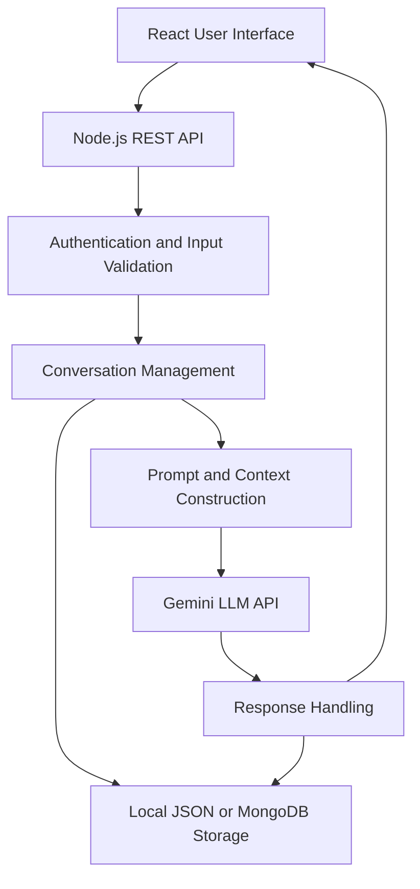

# CleverComm AI

## Full-Stack Generative AI and Technical Communication Assistant

CleverComm AI is a full-stack application designed to help
users interpret technical concepts, improve engineering
documentation and understand visual information through
contextual AI conversations.

The application combines React, Node.js, REST APIs, Large
Language Models (LLMs), multimodal prompt development and
persistent conversation storage.

## Problem Statement

Technical communication frequently involves interpreting
engineering concepts, rewriting documentation, explaining
diagrams and preserving context across follow-up questions.

CleverComm AI explores a unified communication workspace
with specialized prompts, contextual conversations and
controlled access to user data.

## Key Features

- Responsive React graphical user interface.
- Node.js REST API with modular storage adapters.
- User registration and password-based authentication.
- Salted scrypt password hashing.
- HttpOnly session cookies and session revocation.
- Protected routes and account-level conversation isolation.
- Persistent conversations and conversation deletion.
- Gemini LLM API integration.
- Four specialized technical communication modes.
- PNG and JPEG image attachments.
- Recent conversation context in model requests.
- Explicit authorization before sending content to Gemini.
- Image encoding, type and signature validation.
- Local JSON storage and optional MongoDB integration.
- API failure handling and response-time recording.
- Automated backend integration testing.

## System Architecture



## Technical Communication Modes

| Mode | Purpose |
| --- | --- |
| General conversation | General assistance |
| Technical explanation | Step-by-step engineering explanations |
| Documentation review | Improve clarity while preserving values and units |
| Diagram interpretation | Explain visible diagram components and relationships |

Mode-specific instructions are applied to each model request.

Up to twelve recent messages are supplied as text context.
Image bytes are sent only with the attached turn and are
not persisted in the conversation database.

## Installation

Use a supported Node.js version of at least 22.12.

Windows PowerShell:

```powershell
npm.cmd install
npm.cmd test
npm.cmd run build
```

Set GEMINI_API_KEY in the server environment without placing
the key in source code or Git history.

Start the application:

```powershell
npm.cmd start
```

Open http://127.0.0.1:4173 in your browser.

The default Gemini model is gemini-3.5-flash-lite.
Set GEMINI_MODEL to another compatible model if required.

## Storage

The default storage adapter persists accounts, sessions
and conversations to data/store.json.

The optional MongoDB adapter uses MONGODB_URI to connect
to a local or hosted MongoDB deployment.

Both adapters implement the same storage operations.
A configured MongoDB connection must succeed at startup;
the application does not silently switch databases.

Local and MongoDB data are separate.

Database credentials and local user records are excluded
from version control.

## REST API

| Method | Endpoint | Purpose |
| --- | --- | --- |
| GET | /api/health | Configuration status |
| POST | /api/register | Create an account |
| POST | /api/login | Authenticate |
| POST | /api/logout | Revoke session |
| GET | /api/me | Current user |
| GET | /api/chats | List conversations |
| POST | /api/chats | Create conversation |
| GET | /api/chats/:id | Retrieve conversation |
| POST | /api/chats/:id/message | Generate AI response |
| DELETE | /api/chats/:id | Delete conversation |

Conversation endpoints require authentication and enforce
account-level access controls.

## Automated Testing

```powershell
npm.cmd test
```

The test suite contains eight integration scenarios:

1. Protected endpoint access.
2. Registration and password hashing.
3. Conversation creation and context retention.
4. Account isolation.
5. Input, consent and origin validation.
6. Image forwarding and Gemini request construction.
7. AI failure recovery without partial message storage.
8. Persistent storage, logout and deletion.

Tests use a temporary local store and a deterministic mock
AI generator. They do not contact Gemini or require an API
key.

Live Gemini behavior and MongoDB connectivity must be tested
separately.

## Technology Stack

React, JavaScript, Node.js, REST APIs, Vite, Gemini API,
MongoDB Node.js Driver, JSON, HTML, CSS, Git and Node.js
integration tests.

## Responsible AI and Security

The application requires authorization before transmitting
prompts, recent context and attachments to Gemini.

AI-generated content should not be treated as verified
engineering specifications.

Passwords are salted and hashed. Session identifiers are
randomly generated, stored as hashes and transmitted through
HttpOnly cookies.

The application is designed for local demonstrations and
binds to the loopback network interface.

## Limitations

This is an educational portfolio prototype, not an
enterprise-ready authentication or documentation platform.

The local JSON adapter is intended for a single process.
It is not a substitute for a production database.

The prototype does not implement production HTTPS,
account recovery, email verification, distributed rate
limiting, comprehensive security auditing or automated
session cleanup.

Image validation checks type, encoding, size and signature,
not full image decoding or malware detection.

Generated responses are displayed as plain text.
The application does not independently verify AI claims.

Response-time measurements include the external model
request and are affected by network and model conditions.

## Author

Mustafa Al-Juboori

Software Engineering Student

Carleton University, Ottawa, Canada
